# Fortuna Client Portal — Architecture & Handover Overview

**Product:** Fortuna Global Holdings Client Portal  
**Live site:** [https://www.fortunaglobalholdings.com](https://www.fortunaglobalholdings.com)  
**Audience:** Product stakeholders, operators, and technical reviewers  

This document explains the **current** portal architecture with visual flows (the same style used in engineering plans) and a clear **why** for each major technology and design choice.

---

## 1. Purpose

The Fortuna Client Portal is a secure web application that:

- Captures **Request Access** from prospective clients  
- Lets **admins** approve access and operate clients, content, support, and billing  
- Guides each approved client through a structured **17-step onboarding journey**  
- Collects the **onboarding fee**, **signed agreements**, and ongoing **usage billing**  
- Sends transactional **email** (and optional SMS) for access, next steps, and reminders  

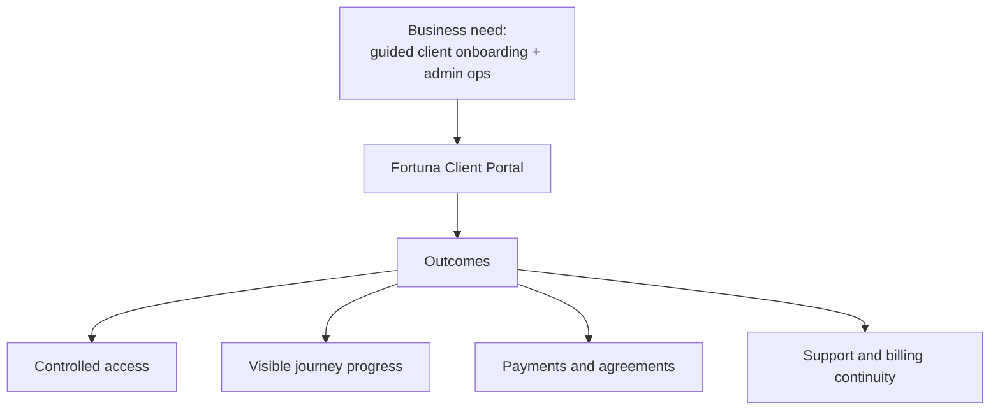

**Why this shape:** Fortuna’s onboarding is multi-week and multi-vendor (VPS, broker, licence portal, EA). A single portal keeps status, communications, and admin oversight in one place instead of spreadsheets and ad-hoc emails.

---

## 2. End-to-end system map

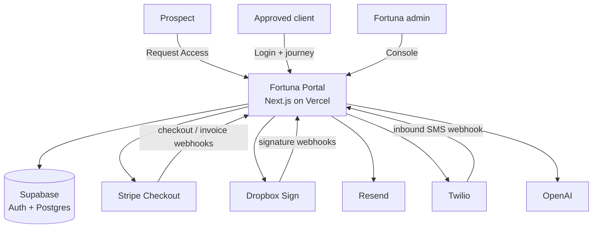

**Why this layout:** The portal is the **orchestrator**. Sensitive actions (auth, payments, e-sign) stay with specialist platforms; the portal records outcomes and unlocks the next onboarding step. Webhooks are used so progress depends on **confirmed events**, not only a user clicking “back to site.”

---

## 3. Technology choices — what & why

Each item below is used in production architecture today.

### 3.1 Next.js (App Router) + React + TypeScript

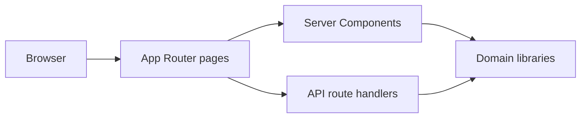

| | |
|--|--|
| **What** | Full-stack web framework: UI, server rendering, and `/api` handlers in one repo. |
| **Why** | One codebase for marketing, client dashboard, admin console, and webhooks. TypeScript reduces integration bugs across Stripe/Supabase payloads. App Router fits auth-gated dashboards and SEO-friendly public pages. |

### 3.2 Vercel (hosting)

| | |
|--|--|
| **What** | Hosts the Next.js app, env vars, and HTTPS endpoints for webhooks/cron. |
| **Why** | Native Next.js deploy path, easy custom domain (`fortunaglobalholdings.com`), and stable public URLs Stripe/Dropbox/Twilio can call. |

### 3.3 Supabase (Auth + Postgres + RLS)

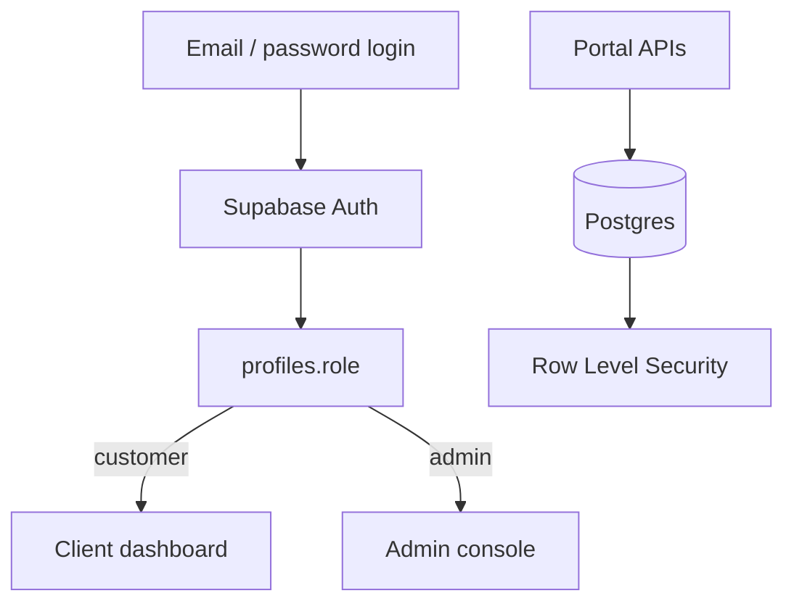

| | |
|--|--|
| **What** | Authentication, user profiles, and the system of record for journeys, payments metadata, support, and audit. |
| **Why** | Avoids building custom auth. Postgres holds structured onboarding state. **RLS** keeps clients to their own rows; admins use elevated policies / service role only on the server. |

### 3.4 Tailwind CSS + shadcn/ui

| | |
|--|--|
| **What** | Styling system and accessible UI primitives (dialogs, tables, forms). |
| **Why** | Fast, consistent admin/client UI without a heavy design system. Radix-based components cover forms, alerts, and data tables needed for ops. |

### 3.5 Stripe

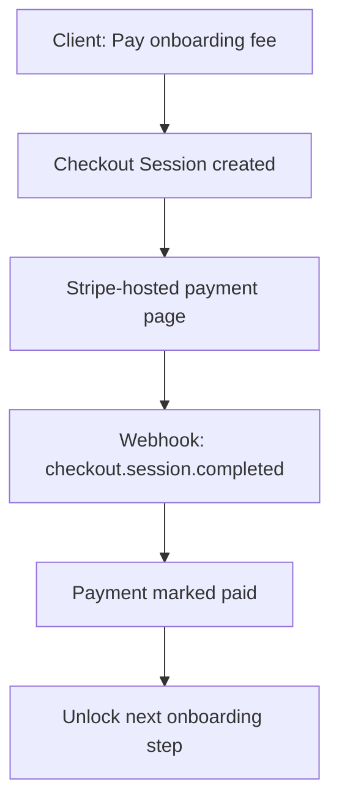

| | |
|--|--|
| **What** | Card payments for the AUD **$2,750** onboarding fee and usage invoices. |
| **Why** | PCI-compliant hosted Checkout; Fortuna never handles raw card data. Webhooks are the reliable signal that money (or a test payment) succeeded. |
| **Current mode** | **Test mode** — flows can be verified without live charges until live keys are enabled. |

### 3.6 Dropbox Sign (HelloSign)

| | |
|--|--|
| **What** | Template-based user agreement signing. |
| **Why** | Legally trackable e-sign without building a document engine. Webhook completion unlocks demo-install steps only after a real signature event. |

### 3.7 Resend

| | |
|--|--|
| **What** | Transactional email (access approved, next steps, support replies, invoices). |
| **Why** | Simple API, branded HTML layout, and a verified Fortuna sending domain — better control than generic SMTP for onboarding sequences. |

### 3.8 Twilio

| | |
|--|--|
| **What** | Optional SMS reminders and inbound SMS webhook handling. |
| **Why** | Some clients engage better by SMS; rules are configurable so ops can enable/disable without code changes. |

### 3.9 OpenAI (portal assistant)

| | |
|--|--|
| **What** | In-portal assistant grounded on Fortuna guide content. |
| **Why** | Reduces repetitive “how do I…?” support load during long demo/setup periods, while keeping answers tied to Fortuna’s own materials. |

### 3.10 Zod

| | |
|--|--|
| **What** | Runtime validation for forms and API bodies. |
| **Why** | Request Access, questionnaire, and admin patches must reject bad data before it hits the database. |

---

## 4. Application architecture (inside the portal)

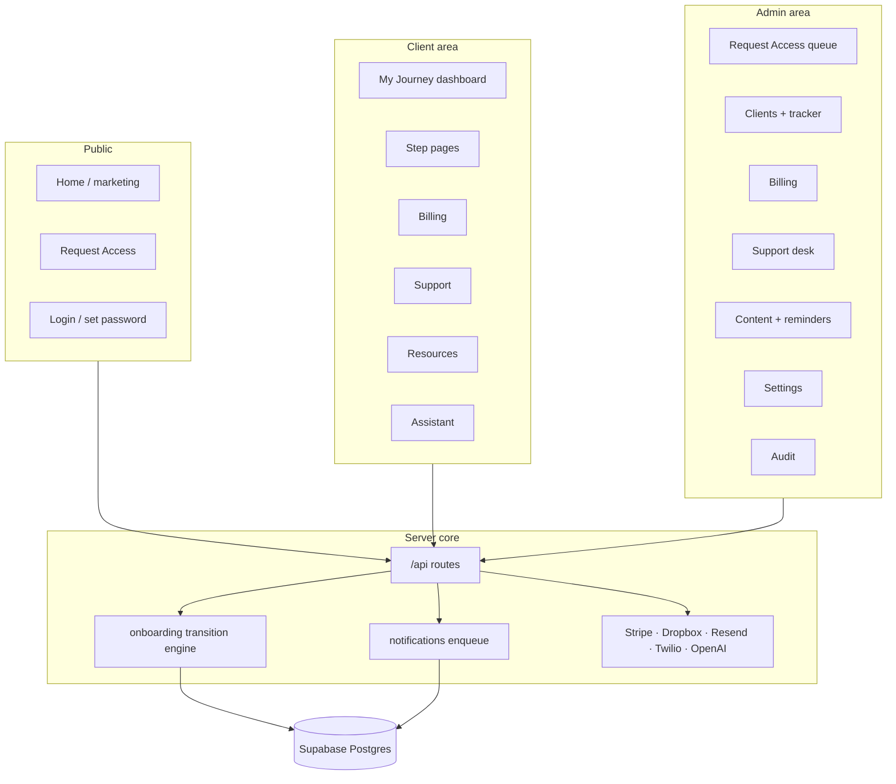

**Why this split:** Public pages convert demand; the **client area** is journey-first; the **admin area** is operations-first. A single **transition engine** (`completeStep`) owns step unlocks so payment webhooks, client confirms, and admin overrides cannot diverge into inconsistent states.

### Repository map

| Path | Why it exists |
|------|----------------|
| `app/` | URL routes for people and machines (pages + APIs) |
| `components/` | Reusable UI for portal and admin |
| `lib/onboarding/` | Canonical 17 steps + case/transition rules |
| `lib/notifications/` | Email/SMS copy and delivery logging |
| `lib/integrations/` | Thin adapters to external vendors |
| `lib/supabase/` | Safe browser vs server vs service-role clients |
| `supabase/migrations/` | Versioned schema and RLS |
| `docs/` | Handover and testing documentation |

---

## 5. Access control & first-time activation

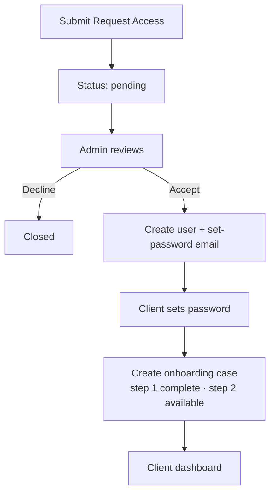

| Role | Why it exists |
|------|----------------|
| **Anonymous** | Anyone can request access without an account |
| **Customer** | Sees only their journey, billing, and tickets |
| **Admin** | Approves people, fixes stuck journeys, issues invoices, manages content |

**Why invite-after-approve:** Keeps the portal closed. Prospects cannot self-provision a paid journey; Fortuna controls who enters onboarding.

---

## 6. Onboarding journey (17 steps)

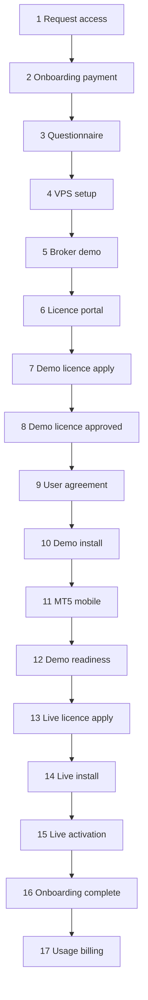

**Why a linear journey:** Matches Fortuna’s real-world operating sequence (pay → setup → demo practice → live). Prerequisites prevent clients from jumping ahead before payment, agreement, or readiness gates.

### How each kind of step advances

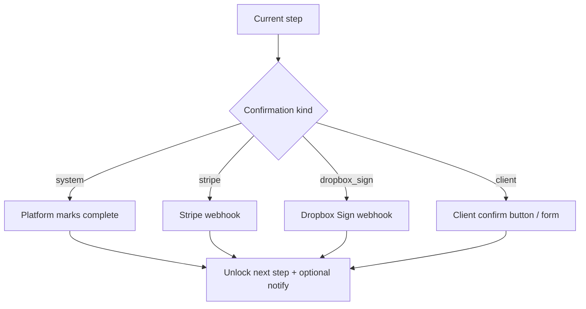

| Kind | Why used |
|------|----------|
| **system** | No client action (e.g. access already approved, or completion after live activation) |
| **stripe** | Fee must be confirmed by the payment provider |
| **dropbox_sign** | Agreement must be confirmed by the signing provider |
| **client** | Operational steps (VPS, broker, licences) are confirmed in-portal; many are honour-system relative to external sites |

### Step groups (why grouped this way)

| Group | Steps | Why |
|-------|--------|-----|
| **Access** | 1–2 | Gate the product behind approval and onboarding fee |
| **Setup** | 3–5 | Collect account facts; stand up VPS + demo broker |
| **Demo** | 6–12 | Licence, legal agreement, install, practice, 28-day readiness |
| **Live** | 13–15 | Parallel path for live licence, install flags, activation |
| **Billing** | 16–17 | Close onboarding; move to recurring usage invoicing |

**Demo readiness (step 12):** Unlocks after **28 days** of demo practice (timer starts at demo install). Admins can force-complete this step when business agrees — intentional exception for a time gate, not a general skip for every step.

**Live install (step 14):** Requires three flags (live licence approved → EA installed → Equity Protect) so partial progress is visible and clients cannot mark “fully installed” in one click.

---

## 7. Money & signature flows (detail)

### 7.1 Onboarding fee

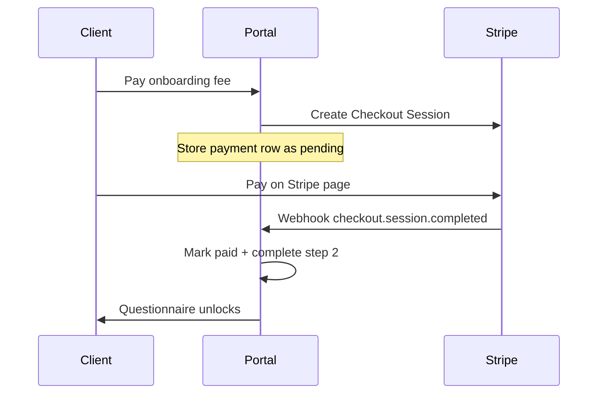

**Why webhook-first:** A success URL (`?paid=1`) can be opened without paying. Stripe’s webhook is the trusted completion signal.  
**Why AUD $2,750 in code/config:** Matches Fortuna’s commercial onboarding fee; changeable when going live with product/ops agreement.

### 7.2 User agreement

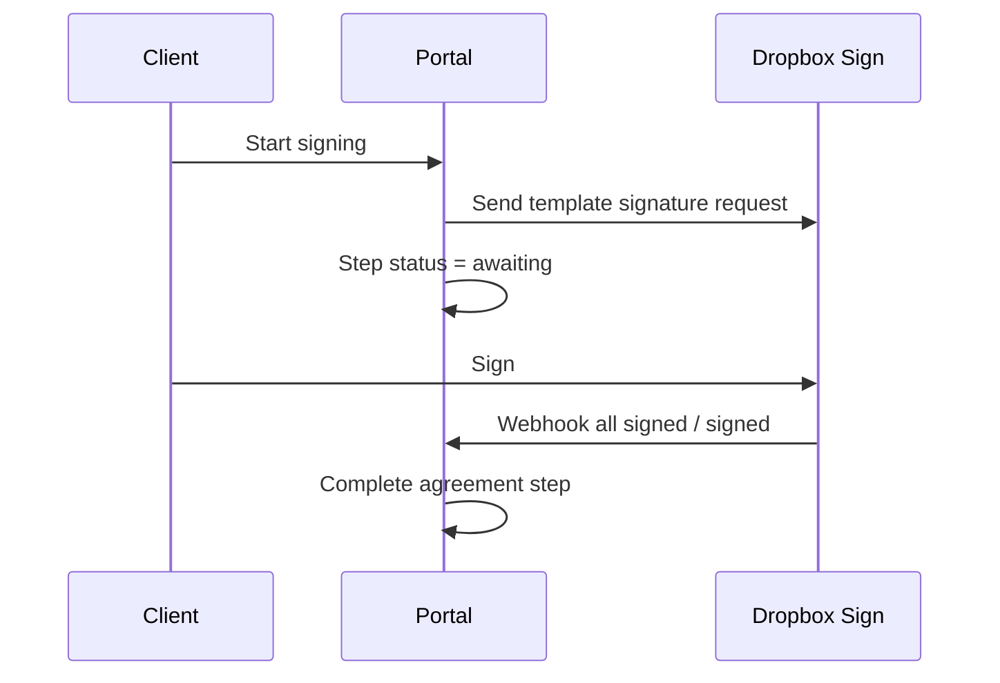

**Why awaiting state:** The UI can show “waiting for signature” while the client is on Dropbox Sign; the journey only continues when the provider confirms.

---

## 8. Admin console — capability map

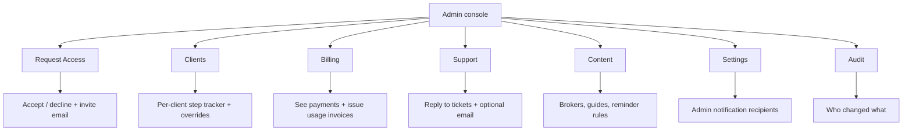

| Area | Why it exists |
|------|----------------|
| Request Access | Human gate before accounts exist |
| Clients | Ops visibility into where each person is blocked |
| Billing | Commercial follow-through after onboarding |
| Support | Keep help inside the product trail |
| Content | Brokers/guides change without redeploying the app |
| Settings | Route ops alerts to the right inbox |
| Audit | Accountability for overrides and invitations |

---

## 9. Notifications architecture

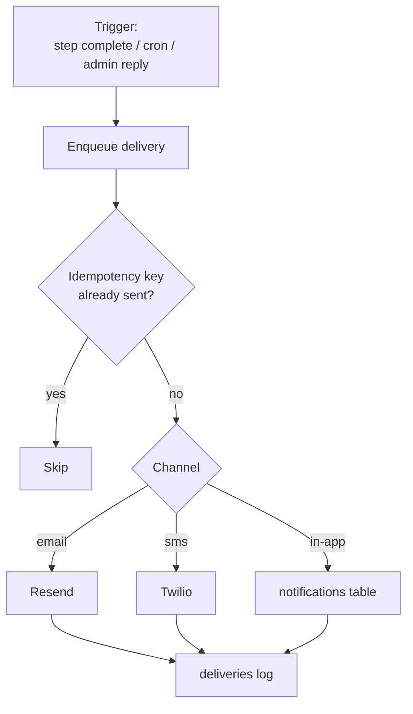

**Why idempotency keys:** Cron and retries must not spam the same reminder twice.  
**Why three channels:** Email for formal steps, SMS for optional nudges, in-app for when the client is already inside the portal.

---

## 10. Data model (why these tables)

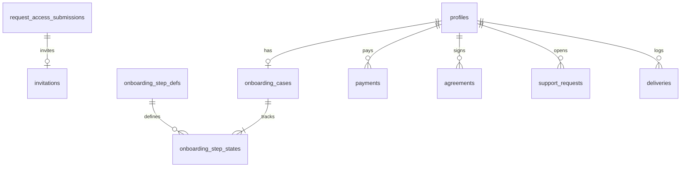

| Entity | Why |
|--------|-----|
| `request_access_submissions` | Store leads before accounts exist |
| `invitations` | Single-use, expiring activation links |
| `onboarding_cases` | One journey timeline per client (timers, status) |
| `onboarding_step_states` | Per-step progress without hard-coding UI-only state |
| `payments` / `agreements` | Link provider IDs to Fortuna users for support and audit |
| `deliveries` | Proof of what was emailed/SMS’d |
| `audit_log` / `webhook_events` | Traceability and duplicate webhook protection |

---

## 11. API map (plan view)

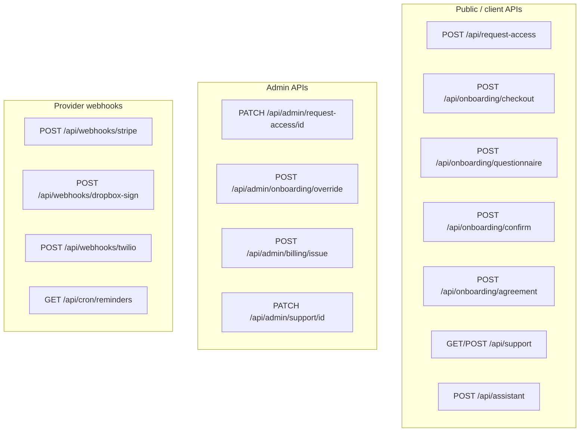

**Why separate webhooks from UI APIs:** Providers call the server with secrets/signatures; browsers call session-authenticated routes. Mixing them would weaken security and make retries harder.

---

## 12. Security design (why these controls)

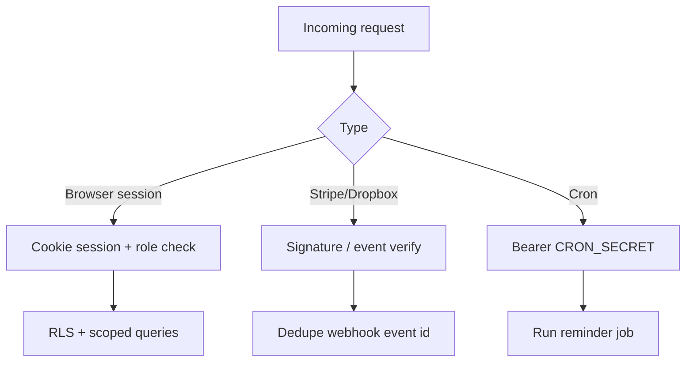

| Control | Why |
|---------|-----|
| Service role only on server | Prevents clients forging admin/journey writes |
| RLS | Defence in depth if a query is mis-scoped |
| Webhook dedupe | Providers retry; progress must not double-apply |
| No raw cards in Fortuna | Stripe Checkout holds PCI burden |
| Support body filters | Reduce accidental sharing of passwords/account numbers in tickets |

---

## 13. Current operational status

| Area | Status | Note |
|------|--------|------|
| Portal + admin | Live | Used for access, journey, and ops |
| Auth / email | Live | Resend + set-password flows |
| Stripe | **Test mode** | Full flow without live charges until keys switch |
| Dropbox Sign | Integrated | Template + webhook path |
| 17-step journey | Complete | Payment → live → usage billing path exists |
| Reminders | Configurable | Admin → Content; can be disabled per rule |

---

## 14. Operator checklist

1. Point Admin → Settings notification emails at monitored inboxes.  
2. Keep at least one **active broker** (and key guides) in Content.  
3. Test with a **new email** when walking Request Access → journey.  
4. Before enabling **live** Stripe keys, confirm the live webhook URL and secret.  
5. Treat the 28-day readiness gate as intentional; force only when agreed.  
6. Use a clear admin process for any client who should **not** pay the onboarding fee.

---

## 15. Related documents

| Document | Why share it |
|----------|----------------|
| [`Fortuna-Client-Testing-Guide.pdf`](./Fortuna-Client-Testing-Guide.pdf) | Step-by-step UAT for stakeholders |
| [`.env.example`](../.env.example) | What must be configured to run the stack |

---

*Fortuna Global Holdings — architecture handover for review and continuity.*
